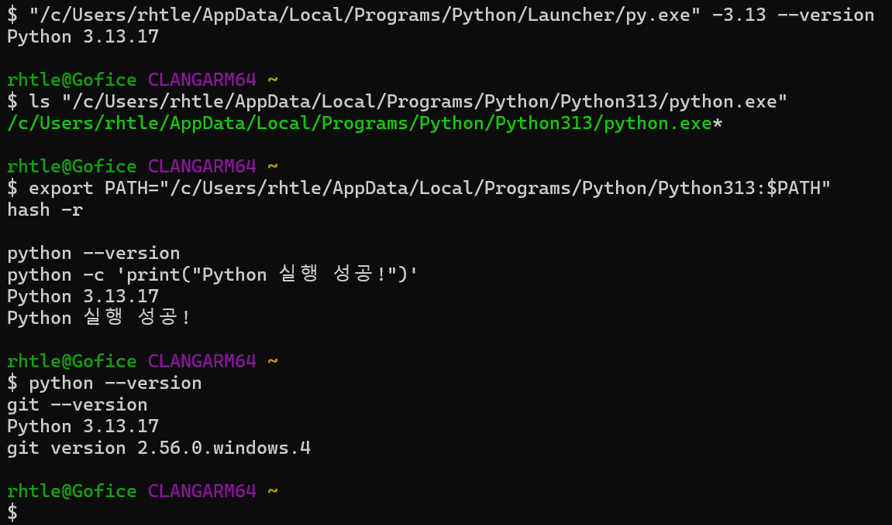
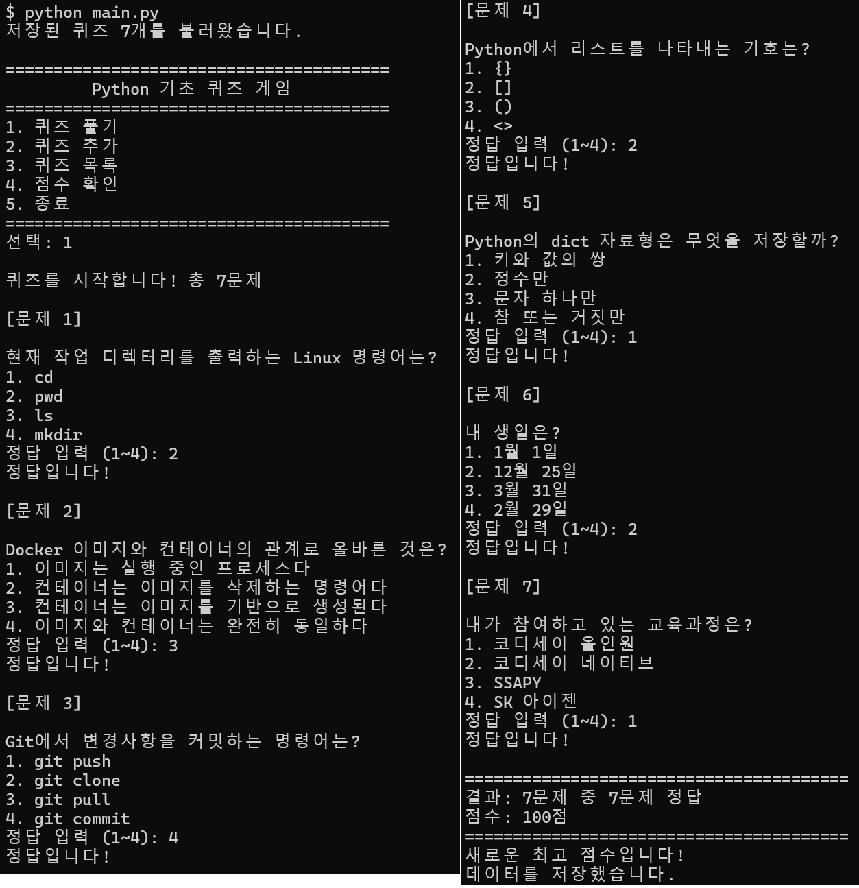
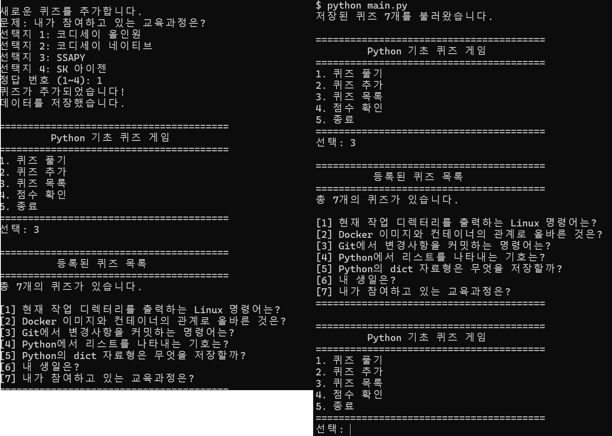
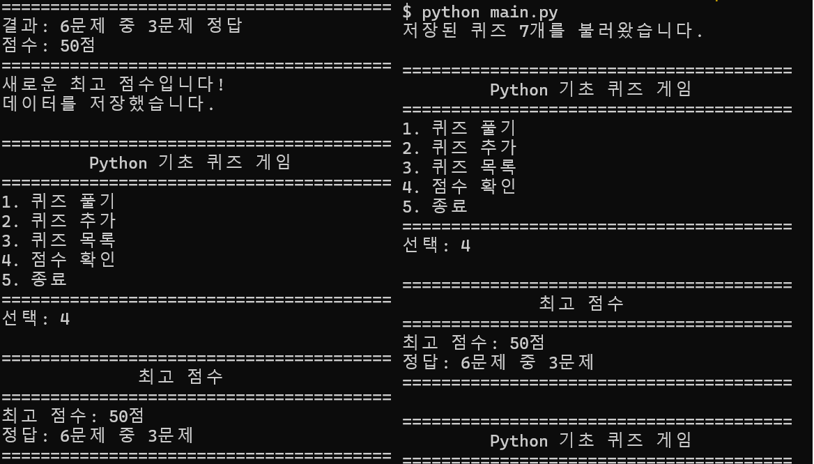
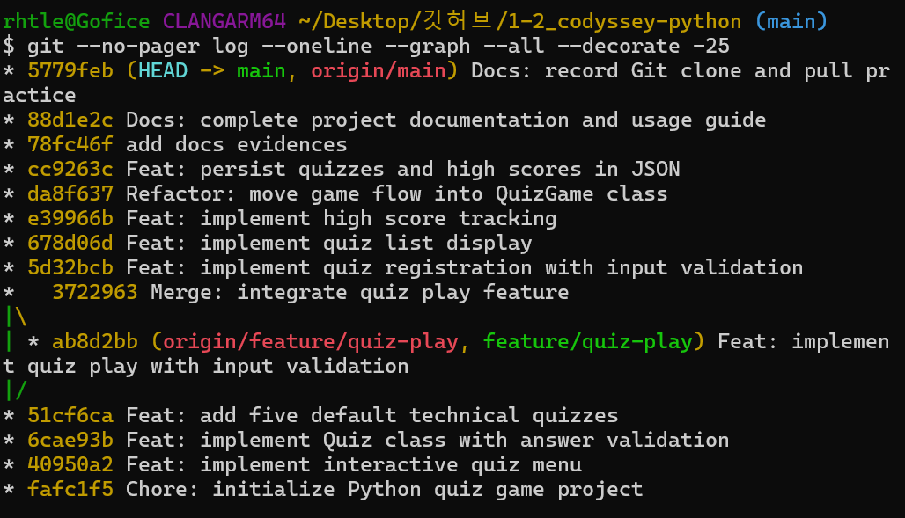
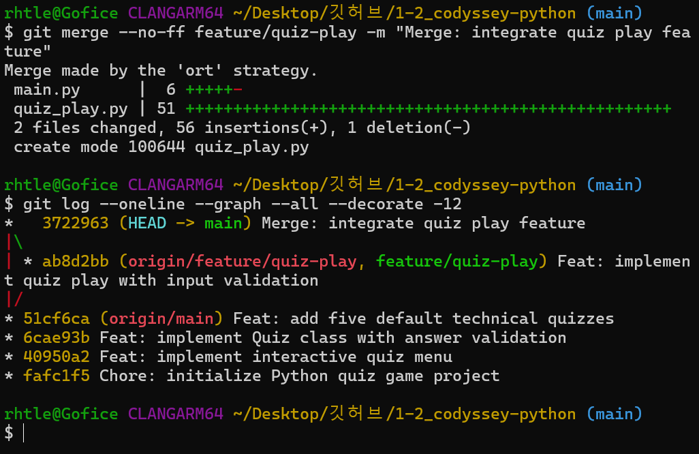
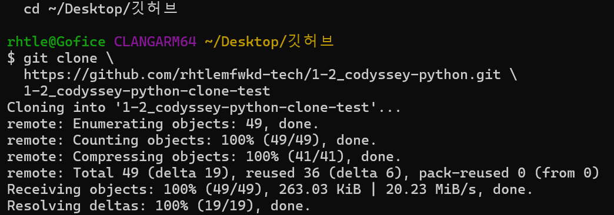
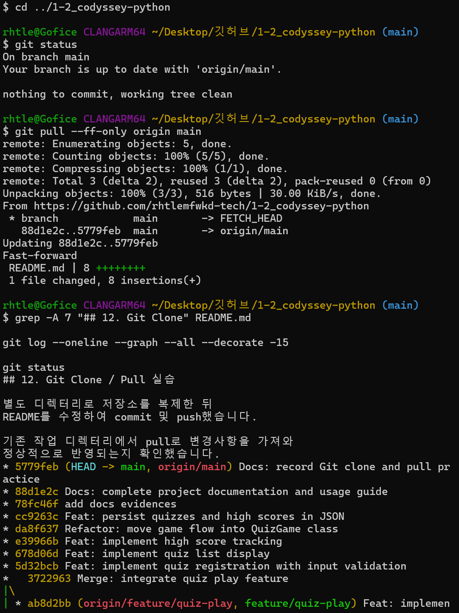
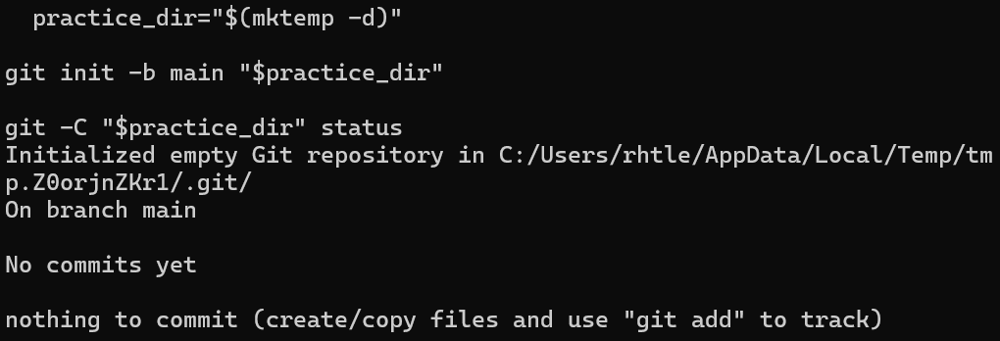
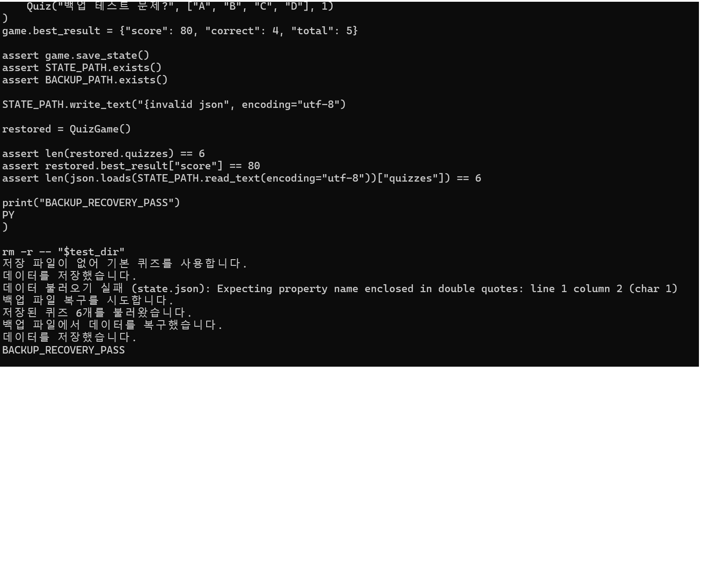

# Python Quiz Game

Python 기초 문법과 객체 지향 프로그래밍을 학습하기 위해
제작한 터미널 기반 퀴즈 게임입니다.

## 1. 프로젝트 개요

사용자가 퀴즈를 풀거나 새로운 문제를 등록할 수 있는
Python 콘솔 프로그램입니다.

MultipleChoiceQuestion과 QuizGame 클래스로 역할을 분리하고,
JSON 파일을 이용해 퀴즈와 최고 점수를 영구 저장합니다.

## 2. 퀴즈 주제 및 선정 이유

주제: Linux, Docker, Git, Python 기초

개발 교육 과정에서 학습한 내용을 복습하고,
실제 개발 환경에서 사용하는 기본 개념을
확실하게 이해하기 위해 선정했습니다.

## 3. 개발 환경

- Python 3.10 이상 (개발 환경: Python 3.13.17)
- Git
- Windows / Git Bash
- Python 표준 라이브러리 사용
- 외부 패키지 설치 불필요

## 4. 실행 방법

저장소를 복제한 뒤 프로젝트 폴더에서 실행합니다.

    git clone https://github.com/rhtlemfwkd-tech/1-2_codyssey-python.git
    cd 1-2_codyssey-python
    python main.py

Python 실행 명령은 운영체제 환경에 따라 다를 수 있습니다.

## 5. 주요 기능

1. 퀴즈 풀기
   - 등록된 문제 출제
   - 정답 및 오답 판정
   - 정답률 기반 점수 계산

2. 퀴즈 추가
   - 문제와 선택지 4개 입력
   - 정답 번호 지정
   - JSON 파일에 저장

3. 퀴즈 목록
   - 등록된 모든 문제 확인
   - 문제 개수 표시

4. 점수 확인
   - 최고 점수 확인
   - 기존 기록보다 높으면 갱신
   - 프로그램 재실행 후에도 기록 유지

5. 종료
   - 안전한 프로그램 종료
   - 종료 시 데이터 저장

## 6. 프로젝트 파일 구조

    1-2_codyssey-python/
    ├── main.py                         # 게임 생성·시작·종료
    ├── multiple_choice_question.py     # 객관식 문제 데이터·정답 판정
    ├── quiz_game_flow.py               # 메뉴·출제·등록·목록·점수
    ├── quiz_json_save_load.py          # JSON 저장·읽기·백업 복구
    ├── default_quiz_questions.py       # 기본 객관식 문제 5개
    ├── tests/                         # 회귀 테스트
    ├── .gitignore
    ├── README.md
    └── docs/screenshots/

실행 시 `state.json`, `state.json.bak`이 로컬에서 생성될 수 있지만 Git에는 포함되지 않습니다.

## 7. 클래스와 모듈 설계

### MultipleChoiceQuestion (`multiple_choice_question.py`)

객관식 문제 1개의 내용·선택지 4개·정답 번호를 보유합니다.
- `show_question()`: 문제와 선택지 출력
- `check_answer()`: 입력한 번호와 정답 비교

### QuizGame (`quiz_game_flow.py`)

게임 실행 중 문제 목록과 최고 기록을 관리합니다.
- `run_menu()`: 메뉴 입력 및 기능 분기
- `play_quiz()`: 문제 출제, 입력, 점수 계산
- `add_question()`: 문제 등록
- `show_question_list()`: 문제 목록 표시
- `show_best_score()`: 최고 기록 표시
- `save_progress()`: JSON 저장 함수 호출

### 독립 함수 모듈

- `quiz_json_save_load.py`: `load_quiz_state()`·`save_quiz_state()` 및 검증·복구
- `default_quiz_questions.py`: `create_default_questions()`으로 기본 문제 5개 생성

데이터 객체 파일은 **무엇을 표현하는지**, 기능 모듈은 **무슨 작업을 하는지**가 드러나도록 이름 지었습니다.

## 8. 데이터 파일 (state.json)

프로젝트 루트의 state.json에 UTF-8 형식으로 저장합니다.

데이터의 주요 필드는 다음과 같습니다.

- quizzes: 퀴즈 객체의 데이터 목록
- question: 문제 문자열
- choices: 선택지 문자열 목록
- answer: 정답 번호 (1~4)
- best_score: 최고 점수 기록
- score: 100점 기준 점수
- correct: 정답 개수
- total: 전체 문제 수

best_score는 기록이 없을 때 null이며,
기록이 있으면 score, correct, total을 가진 객체입니다.

파일이 없으면 기본 퀴즈 5개로 시작합니다.
원본이 손상되면 백업에서 복구하고, 둘 다 손상되면 기존 파일을 보존한 채 자동 저장을 차단합니다.

state.json은 .gitignore에 등록되어 Git에 포함되지 않습니다.

## 9. 예외 처리

- 숫자가 아닌 입력 처리
- 빈 입력 및 앞뒤 공백 처리
- 메뉴와 정답 번호의 범위 검사
- Ctrl+C 및 EOF 입력 처리
- JSON 파일 누락 및 손상 복구
- 파일 입출력 오류 처리

## 10. Git 학습 내용

- git init / add / commit / push
- git checkout을 이용한 브랜치 생성 및 전환
- git merge를 이용한 기능 브랜치 병합
- git clone을 이용한 저장소 복제
- git pull을 이용한 원격 변경사항 동기화

기능별 커밋으로 개발 이력을 관리했습니다.

## 11. 학습 내용

- 변수와 기본 자료형
- 조건문과 반복문
- 함수와 반환값
- 클래스와 객체
- 리스트와 딕셔너리
- JSON 파일 입출력
- 예외 처리
- Git 버전 관리

## 12. Git Clone / Pull 실습

별도 디렉터리로 저장소를 복제한 뒤
README를 수정하여 commit 및 push했습니다.

기존 작업 디렉터리에서 pull로 변경사항을 가져와
정상적으로 반영되는지 확인했습니다.
## 13. 실행 화면 및 개발 증빙

### 13.1 개발 환경

Python 3.13.17과 Git 설치 및 실행 환경입니다.

### 13.2 퀴즈 플레이

실제 문제 출제 및 정답 입력 화면입니다.

### 13.3 퀴즈 추가 및 데이터 영속성

새로운 퀴즈를 등록하고 프로그램을 재실행해도
퀴즈 목록이 유지되는 것을 확인했습니다.

### 13.4 최고 점수 영구 저장

프로그램 재실행 후에도 최고 점수가 유지됩니다.

### 13.5 Git 커밋 이력

기능 단위로 10개 이상의 의미 있는 커밋을 작성했습니다.

### 13.6 브랜치 생성 및 병합

feature/quiz-play 브랜치에서 기능을 구현한 뒤
main 브랜치에 병합했습니다.

### 13.7 Git Clone

기존 저장소를 별도 디렉터리에 복제했습니다.

### 13.8 Git Pull

복제 저장소에서 README를 수정하고 Push한 뒤,
원본 저장소에서 Pull하여 변경사항을 가져왔습니다.

### 13.9 Git Init

별도 실습 디렉터리에서 Git 저장소를 초기화했습니다.

### 13.10 자동 백업 및 복구

state.json 손상 시 state.json.bak에서
퀴즈와 최고 점수를 복원하는 테스트를 수행했습니다.

## 14. 설계 결정 및 한계

### 객체 지향 설계

`MultipleChoiceQuestion`은 문제 한 개와 정답 판정만 담당합니다.
`QuizGame`은 게임 진행과 메모리 상태를 담당합니다.
`quiz_json_save_load.py`는 JSON 저장·검증·백업 복구를 담당합니다.

초기에는 작은 기능을 8개 파일에 나누었으나 호출 흐름이 불분명하여,
게임 상태를 사용하는 로직을 `QuizGame`에 묶었습니다.
파일 수를 줄이는 것 자체가 목적이 아니라 변경 이유에 따라 코드를 묶는 것이 목적입니다.

### 데이터 저장 전략

프로그램 시작 시 state.json을 읽고,
퀴즈 추가 또는 최고 점수 갱신 시 저장합니다.
프로그램 종료 시에도 저장을 시도합니다.

JSON은 사람이 읽기 쉽고 외부 라이브러리가 필요 없다는
장점이 있지만, 데이터가 많아지면 파일 전체를 읽고
쓰는 방식이 비효율적일 수 있습니다.

저장 시 임시 파일을 작성하고 os.replace()로 교체하여
파일 쓰기 중 기존 파일이 일부만 덮어써지는 위험을 줄였습니다.

정상 저장 시 state.json.bak 백업본도 갱신합니다.
원본이 없거나 손상되면 백업본을 자동 검증하고 복원합니다.
원본과 백업이 모두 손상되면 기본 퀴즈를 메모리에서 사용하되 자동 저장은 차단해 기존 파일을 보호합니다.

백업은 최신 저장 상태의 복사본 1개이며,
과거 여러 버전으로 되돌리는 기능은 제공하지 않습니다.
대규모 데이터 관리가 필요해지면 SQLite 등을 고려할 수 있습니다.

### 입력 및 예외 처리

`QuizGame.run_menu()`는 메뉴 입력을 처리합니다.
`QuizGame.play_quiz()`는 정답 입력을, `QuizGame.add_question()`은 문제 등록을 처리합니다.
입력 오류는 재입력을 요청하고 Ctrl+C/EOF로 중단할 수 있습니다.
파일 읽기·쓰기 오류는 `quiz_json_save_load.py`에서 처리합니다.

### Git 브랜치 전략

main은 안정적인 코드를 유지하고,
feature/quiz-play 브랜치에서 퀴즈 플레이 기능을 개발했습니다.

검증 후 --no-ff 방식으로 병합 커밋을 남겨
기능 개발 이력을 추적할 수 있도록 했습니다.

커밋 메시지에는 주로 Feat, Fix, Refactor, Docs 등의
접두사를 사용하여 변경 목적을 나타냈습니다.
## 15. 이름과 책임을 명확히 한 리팩터링

- 이전: `Quiz`, `QuizGame` 클래스 + 여러 작은 기능 모듈
- 현재: `MultipleChoiceQuestion`, `QuizGame` 클래스 + 명시적 JSON 입출력 모듈
- Python 실행 파일 5개. 기존 JSON 키(`quizzes`, `best_score`)와 저장 형식 유지
- 원본·백업이 모두 손상되면 덮어쓰지 않아 기존 사용자 데이터 보호
- 기존 Git 실습 이력과 스크린샷은 이전 구현 당시의 증빙
